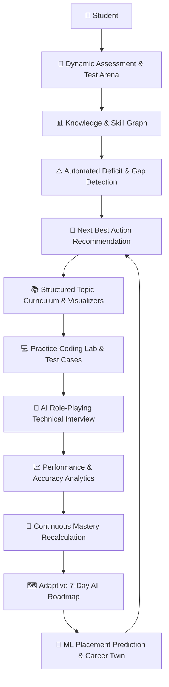

# LearnX — AI-Powered Student Growth & Career Intelligence Platform

> **"Learn. Practice. Grow. Succeed."**  
> *A Production-Grade Personal AI Learning, Assessment & Career Intelligence Ecosystem for Computer Science Students.*

---

## 📌 Architecture & Learning Feedback Loop

LearnX transforms traditional engineering education into an active, data-driven mastery cycle:



---

## 🌟 Comprehensive Platform Modules & Features

### 1. 🏠 Intelligent Student Command Center (`/dashboard`)
- **Real-time KPI Tracking**: Live calculation of Overall Progress, Placement Probability, Active Learning Streak, and Weekly Learning Velocity.
- **Next Best Action Card**: Contextual recommendation pinpointing the student's highest-priority weak topic (e.g., *DBMS Normalization at 38% accuracy vs. 70% placement target*) with direct 15-minute practice and AI tutor shortcuts.
- **Daily Goals & Habit Tracker**: Locally persisted interactive checklist synchronized with active semester coursework.
- **Subject Domain Snapshot**: Clean progress and accuracy gauges across all major CSE tracks.
- **Quick-Access Capabilities**: Direct launchpads for Assessments, Coding Lab, Mock Interviews, AI Tutor, and Career Twin.

---

### 2. 📝 Production Diagnostic & Assessment Platform (`/test` / `/assessments`)
- **Large Curated Question Bank**: **921+ authentic, verified CSE assessment questions** stored in MongoDB Atlas across 9 core technical subjects (no placeholder or duplicate data).
- **Strict Subject & Topic Isolation**:
  - Independent topic selection (e.g. *DSA $\rightarrow$ Binary Search* loads strictly Binary Search questions).
  - Immediate state reset and request cancellation (`activeRequestIdRef`) preventing cross-subject data contamination or stale response overwrites.
- **Test Configuration Modal**:
  - Configurable question counts: `10`, `20`, `30`, `50`, `75`, `100`, or `Custom`.
  - Hard limit validation: Prevents requesting more questions than available in the database, with informative user alerts.
  - Difficulty selection: *All Difficulties*, *Easy*, *Medium*, *Hard*.
- **Resilient Active Test Runner**:
  - **Zero Answer Loss**: Answers remain saved when navigating using `← Previous`, `Save & Continue →`, or the Question Palette.
  - **Session Persistence**: Test progress (answers, current index, marked flags, elapsed time) is saved in `localStorage` and seamlessly survives browser refreshes.
  - **Interactive Question Palette**: 4 distinct visual states: *Answered* (emerald), *Current* (indigo active ring), *Marked for Review* (amber flag 🚩), and *Not Visited* (slate).
  - **Live Auto-Submitting Timer**: Authoritatively submits when time expires.
- **Authoritative Submission & LearnX Diagnostic Report**:
  - Evaluates scores and accuracy against actual test questions on the backend.
  - Displays Score %, Accuracy %, Attempted, Correct, Wrong, Skipped, and Time Used.
  - Topic Mastery Breakdown with dynamic progress bars.
  - AI-generated Diagnostic Summary and recommended revision tasks.
  - Expandable **Solution & Explanation Review** for every question.
  - Historical Assessment Attempts log modal.

---

### 3. 📚 Hierarchical Curriculum & Topic Learning Engine (`/curriculum`, `/learn`)
- **Hierarchical Knowledge Base**: Structured as `Subject → Unit → Chapter → Topic` matching university standards and competitive exams.
- **6-Part Structured Content Delivery**:
  1. *📌 TL;DR*: Quick conceptual snapshot.
  2. *💡 Simple Explanation*: Clear breakdown with English/Hinglish toggle for intuitive understanding.
  3. *🌍 Real-World Analogy*: Tangible systems comparison (e.g., database indexing vs. library catalog).
  4. *🪜 Step-by-Step Walkthrough*: Code snippets and algorithmic traces.
  5. *⚠️ Common Pitfalls & Edge Cases*: Real interview mistakes to avoid.
  6. *❓ Quick Check MCQ*: Instant retention validation.
- **Rich Learning Tools**: Interactive note-taking, topic bookmarking, mark-as-completed progress tracking, and direct transition to practice.

---

### 4. 🔬 Interactive Computer Science Visualizers (`/visualizer`)
Interactive step-by-step visualizers to develop algorithmic intuition:
- **Binary Search Tree (BST) Visualizer**: Real-time animated node insertion, search path highlighting, deletion, and in-order/pre-order traversals.
- **Stack & Queue Visualizer**: Visual LIFO/FIFO representations with animated push, pop, enqueue, dequeue, and overflow/underflow boundary checks.
- **CPU Process Scheduling Visualizer**: Interactive Gantt chart generator simulating *First Come First Served (FCFS)*, *Shortest Job First (SJF)*, *Round Robin (RR)*, and *Shortest Remaining Time First (SRTF)* with turnaround and waiting time tables.
- **DBMS Normalization & Dependency Visualizer**: Interactive functional dependency mapping and step-by-step decomposition into 1NF, 2NF, 3NF, and BCNF.

---

### 5. 💻 Interactive Coding Lab (`/coding`)
- **In-Browser Code Runner**: Multi-language support (Python, JavaScript, C++, Java).
- **Curated Problem Bank**: Graded by difficulty (Easy, Medium, Hard) and tag (Arrays, Dynamic Programming, Strings, Trees).
- **Automated Test Suite**: Evaluates against hidden and public test cases with execution time and memory measurement.
- **Code Assistant**: Integrated AI code review, hints, complexity analysis ($O(N)$ time / space bounds), and submission history.

---

### 6. 🤖 24/7 Context-Aware AI Tutor & Voice Companion (`/tutor`)
- **Curriculum & Weakness Context**: Automatically injected with the student's current active topic and detected weak areas.
- **One-Click Query Prompts**:
  - *Explain Simply*
  - *Show Code Example*
  - *Give Real-Life Analogy*
  - *Quiz Me*
  - *Common Interview Mistakes*
  - *Exam-Style Answer*
- **Speech Synthesis / Voice Companion**: Listen to concept summaries spoken aloud with voice controls for auditory learners.

---

### 7. 👔 AI Mock Interview Arena (`/interview`)
- **Role-Based Simulations**: Frontend Engineer, Backend Systems, Fullstack Developer, and SDE-1 tracks.
- **Interactive Technical & Behavioral Dialogue**: Real-time voice and text questions posed by an AI technical interviewer.
- **Rubric-Based Evaluation**: Automated feedback scoring technical accuracy, communication clarity, problem-solving structure, and areas for improvement.

---

### 8. 🎯 AI Career Twin & Placement Intelligence (`/career`, `/career-twin`)
- **Digital Career Avatar**: Models the student's skills against real engineering profiles at companies like Google, Amazon, Microsoft, TCS, Infosys, and startups.
- **Gap & Deficit Matrix**: Identifies missing technical competencies, frameworks, and system design concepts required for target roles.
- **Resume Keyword Optimizer**: Highlights missing keywords in student projects to clear ATS screening.
- **Salary & Readiness Forecast**: Predicts interview clearing probability based on continuous test and coding performance

---

### 9. 🗺️ Personalized 7-Day AI Learning Roadmap (`/roadmap`)
- **Adaptive Remediation**: Generates a tailored 7-day study plan dynamically targeting the student's specific weak topics.
- **Daily Milestone Schedule**: Breaks complex subjects into manageable daily goals (30-60 min/day) combining concept review, coding practice, and self-checks.
- **Progress Sync**: Completing roadmap topics automatically updates the global skill profile.

---

### 10. 📊 Interactive Skill Graph & Knowledge Topology (`/skill-graph`)
- **Visual Concept Graph**: Interactive network graph showing dependencies and prerequisites between computer science topics.
- **Mastery Heatmap**: Nodes dynamically colored by user mastery:
  - 🟢 **Mastered / Strong** ($\ge 70\%$)
  - 🔵 **Developing** ($40\% - 69\%$)
  - 🟡 **Weak / At Risk** ($< 40\%$)
  - ⚪ **Unexplored**
- **Prerequisite Guidance**: Click any node to view dependent concepts, mastery level, and recommended practice.

---

### 11. 🏆 Gamification, Learning Streaks & Rewards Hub (`/rewards`)
- **Experience Points (XP)**: Earn XP for completing topics, passing assessments, solving coding problems, and taking mock interviews.
- **Daily Learning Streaks**: Encourages consistency with streak counters and fire milestones.
- **Achievement Badges**: Unlock badges like *DSA Ninja*, *Bug Hunter*, *SQL Maestro*, *Consistent Learner*, and *Speed Demon*.
- **Rewards Store**: Redeem accumulated points for custom platform perks, certificates, and badges.

---

### 12. 📱 Offline-First Learning & PWA Sync (`/offline`)
- **Progressive Web App (PWA)**: Installable on desktop and mobile devices with Service Worker asset caching.
- **IndexedDB Local Storage**: Save study notes, read cached curriculum chapters, and attempt practice quizzes offline without internet connectivity.
- **Background Synchronization**: Automatically syncs completed offline quizzes and notes back to the cloud when internet connection is restored.

---

### 13. 🎓 Faculty & Institutional Governance Dashboard (`/teacher`)
- **Batch & Class Health Overview**: Aggregate analytics across CSE student cohorts.
- **At-Risk Student Alerts**: Automated early warning flags for students falling behind in core curriculum subjects or attendance.
- **Class Weak Topic Detection**: Pinpoints topics where class-wide assessment averages drop below 50% to inform lecture adjustments.
- **Audit Logging & Security**: Complete immutable audit trail for assessments, submissions, and logins.

---

## 📊 Question Bank & Subject Coverage

The platform features **921 real, hand-verified assessment questions** with zero placeholder duplication:

| Subject Domain | Canonical ID | Questions in DB | Core Topics Included |
| :--- | :---: | :---: | :--- |
| **Data Structures & Algorithms** | `DSA` | **105** | Arrays, Linked Lists, Stacks, Queues, Binary Search, Sorting, Recursion, Trees, Graphs, Dynamic Programming, Greedy, Hashing, Heaps, Tries, Backtracking |
| **Database Management Systems** | `DBMS` | **104** | ER Model, Relational Model, Keys, Functional Dependencies, Normalization (1NF-BCNF), SQL Queries, Joins, Transactions, Concurrency, Indexing, B+ Trees, ACID, Recovery |
| **Operating Systems** | `OS` | **110** | Processes, Threads, CPU Scheduling (FCFS/SJF/RR), Deadlocks, Memory Management, Paging, Segmentation, Virtual Memory, File Systems, Synchronization |
| **Computer Networks** | `CN` | **110** | OSI 7 Layers, TCP/IP, IP Addressing, Subnetting, Routing Protocols, TCP Handshake, UDP, DNS, HTTP/HTTPS, Network Security & TLS |
| **Object Oriented Programming** | `OOP` | **108** | Classes, Objects, Inheritance, Polymorphism, Encapsulation, Abstraction, Interfaces, SOLID Principles, Design Patterns |
| **System Design & Architecture** | `SYSTEM_DESIGN` | **90** | Scalability, Load Balancing, Caching (Redis/Memcached), Database Sharding, Message Queues (Kafka/RabbitMQ), Microservices, CAP Theorem, CDN |
| **Web Development** | `WEB_DEV` | **86** | HTML5 Semantics, CSS3 Flex/Grid, JavaScript Core & ES6+, DOM, React 18 Hooks/Lifecycle, Node.js Event Loop, REST APIs, Web Security (XSS/CSRF/CORS), Core Web Vitals |
| **Aptitude & Logical Reasoning** | `APTITUDE` | **104** | Quantitative Aptitude, Percentages & Profit/Loss, Time & Work, Speed Distance Time, Permutations & Probability, Series, Blood Relations, Verbal Ability, Data Interpretation |
| **Programming Core & Systems** | `PROGRAMMING` | **104** | C/C++ Pointers & Memory Management, Java Core & JVM Architecture, Python Internals & GIL, Bit Manipulation, Concurrency & Recursion |
| **Total Available Bank** | — | **921** | **All Unique, Verified Multiple-Choice Questions** |

---

## 🛠️ Complete Technology Stack

```text
┌────────────────────────────────────────────────────────────────────────┐
│                               FRONTEND                                 │
│  React 18  ·  Vite 5  ·  Tailwind CSS  ·  Framer Motion  ·  Recharts   │
│  Lucide Icons  ·  React Router DOM v6  ·  Service Worker PWA           │
├────────────────────────────────────────────────────────────────────────┤
│                                BACKEND                                 │
│  Node.js (LTS)  ·  Express.js  ·  Mongoose ODM  ·  JWT Authentication  │
│  Helmet Security Headers  ·  Rate Limiting  ·  XSS Sanitization        │
├────────────────────────────────────────────────────────────────────────┤
│                           MACHINE LEARNING                             │
│  Python 3  ·  Scikit-Learn  ·  Gradient Boosting  ·  Ridge Regression  │
│  Joblib Serialization  ·  Pandas & NumPy Pipeline                      │
├────────────────────────────────────────────────────────────────────────┤
│                           DATABASE & STORAGE                           │
│  MongoDB Atlas (Cloud Cluster)  ·  IndexedDB (Browser Offline Store)   │
├────────────────────────────────────────────────────────────────────────┤
│                             AI INTEGRATION                             │
│  OpenRouter / OpenAI APIs  ·  GPT-4o-Mini  ·  Gemini-2.5-Flash         │
└────────────────────────────────────────────────────────────────────────┘
```

---

## 📁 Repository Directory Structure

```text
student-platform/
├── backend/
│   ├── config/
│   │   ├── db.js                     # MongoDB connection with autoSeed integration
│   │   └── ai.js                     # AI Client factory (OpenRouter/OpenAI)
│   ├── controllers/
│   │   ├── testController.js         # Assessment engine, dynamic counts, scoring
│   │   ├── learningController.js     # Curriculum, units, chapters & topics
│   │   ├── tutorController.js        # 6-part AI Tutor logic & prompt engineering
│   │   ├── codingController.js       # Code execution & test case evaluation
│   │   ├── interviewController.js    # AI mock interview simulation & rubric
│   │   ├── careerTwinController.js   # Digital career twin & dream company matrix
│   │   ├── skillGraphController.js   # Knowledge topology & mastery calculation
│   │   ├── rewardController.js       # XP, streaks, badges & reward ledger
│   │   ├── examPrepController.js     # University exam copilot & pyq bank
│   │   ├── predictionController.js   # Placement readiness prediction
│   │   ├── institutionController.js  # Faculty & at-risk student monitoring
│   │   └── authController.js         # JWT auth, profile & role-based access
│   ├── middleware/
│   │   ├── auth.js                   # JWT authentication guard
│   │   └── securityMiddleware.js     # Rate limiting, CSP, XSS sanitization
│   ├── models/
│   │   ├── Question.js               # Assessment questions schema & indexes
│   │   ├── TestResult.js             # Detailed attempt records & breakdown
│   │   ├── Curriculum.js             # Subject, Unit, Chapter, Topic schemas
│   │   ├── User.js                   # Student, teacher & admin accounts
│   │   ├── MockInterview.js          # Interview transcripts & AI scores
│   │   ├── CareerTwin.js             # Career readiness & skills gap snapshot
│   │   ├── RewardTransaction.js      # XP points audit trail
│   │   └── UserBadge.js              # Unlocked student achievement badges
│   ├── routes/                       # Express REST routers (/api/tests, /api/auth, etc.)
│   ├── seed/
│   │   ├── questions/                # 9 modular subject question banks (921 Qs)
│   │   │   ├── dsa.js, dbms.js, os.js, cn.js, oop.js
│   │   │   ├── systemDesign.js, webDev.js, aptitude.js, programming.js
│   │   │   └── index.js
│   │   └── seedComprehensiveQuestions.js # Full database population script
│   └── server.js                     # Main Express server entry point
├── frontend/
│   ├── public/
│   │   ├── sw.js                     # Progressive Web App Service Worker
│   │   └── assets/                   # Static logos, avatars, icons
│   ├── src/
│   │   ├── components/
│   │   │   ├── visualizer/           # BST, Stack/Queue, Scheduling, Normalization
│   │   │   ├── voice/                # Audio companion & speech synthesis
│   │   │   ├── Sidebar.jsx           # Global 10-module navigation sidebar
│   │   │   └── TopHeader.jsx         # User status, notifications & quick search
│   │   ├── context/
│   │   │   ├── AuthContext.jsx       # User authentication state
│   │   │   ├── AppStateContext.jsx   # Global mastery, XP & prediction sync
│   │   │   └── OfflineContext.jsx    # Online/offline network status provider
│   │   ├── pages/
│   │   │   ├── Dashboard.jsx         # Main student command center
│   │   │   ├── TestPage.jsx          # Diagnostic testing, config modal & test runner
│   │   │   ├── TopicLearningPage.jsx # Structured concept learning with Hinglish
│   │   │   ├── CodingLabPage.jsx     # In-browser multi-language coding editor
│   │   │   ├── Tutor.jsx             # 24/7 6-part AI Tutor interface
│   │   │   ├── MockInterviewPage.jsx # AI-powered technical mock interview
│   │   │   ├── CareerTwinPage.jsx    # Career Twin & dream company gap matrix
│   │   │   ├── SkillGraphPage.jsx    # Interactive concept dependency graph
│   │   │   ├── RewardsPage.jsx       # Gamified achievements, streaks & XP store
│   │   │   ├── ExamPrepPage.jsx      # University exam cheat sheets & PYQs
│   │   │   ├── OfflineLearning.jsx   # Offline note-taking & cached lessons
│   │   │   └── TeacherDashboard.jsx  # Faculty analytics & student intervention
│   │   ├── services/
│   │   │   ├── api.js                # Axios HTTP client with interceptors
│   │   │   └── indexedDBService.js   # Browser offline persistence engine
│   │   └── App.jsx                   # React Router route registry
│   └── vite.config.js                # Vite build and proxy configuration
├── ml/                               # Supervised ML Placement Readiness Engine
│   ├── data/                         # Synthetic prototype dataset generator
│   ├── models/                       # Serialized Gradient Boosting & Ridge weights
│   └── scripts/                      # Training, cross-validation & prediction scripts
├── vercel.json                       # Vercel serverless deployment routing
└── README.md                         # Project documentation
```

---

## 🚀 Getting Started (Local Setup)

### Prerequisites
- **Node.js** v18+ or v20+
- **npm** v9+
- **Git**
- **MongoDB Atlas Connection** (or local MongoDB on port 27017)

---

### ⚡ Quick Start in 3 Steps

```bash
# 1. Clone the repository
git clone https://github.com/vijaysingh0022/student-platform.git
cd student-platform

# 2. Install all dependencies (Backend + Frontend)
npm run setup

# 3. Seed Comprehensive Question Bank (921 Questions)
node backend/seed/seedComprehensiveQuestions.js

# 4. Start both Backend & Frontend in parallel
npm run dev
```

The application is now live at:
- **Frontend**: [http://localhost:3000](http://localhost:3000)
- **Backend API**: [http://localhost:5001](http://localhost:5001)

---

### Running in Separate Terminals

**Terminal 1 — Backend:**
```bash
cd backend
npm install
npm run dev
```

**Terminal 2 — Frontend:**
```bash
cd frontend
npm install
npm run dev
```

---

## 🔑 Default Demo Accounts

Upon initial startup, the platform is seeded with pre-configured accounts:

| Role | Email | Password | Access Capabilities |
| :--- | :--- | :--- | :--- |
| **Student** | `demo@example.com` | `password123` | Dashboard, Assessments, Coding Lab, AI Tutor, Career Twin, Rewards, Offline Hub |
| **Faculty / Admin** | `teacher@example.com` | `password123` | Cohort Analytics, Weak Topic Analysis, At-Risk Student Flags, Class Reports |

> 💡 **Instant Testing**: You can also click the **"⚡ 1-Click Instant Demo Student Login"** button on the Login page for immediate zero-credential access.

---

## ⚙️ Environment Variables

Create or customize `.env` in the root or `backend/.env`:

```env
# MongoDB Connection URI (Atlas recommended)
MONGO_URI=mongodb+srv://<username>:<password>@cluster0.mongodb.net/student-platform?retryWrites=true&w=majority

# Backend Server Port (default: 5001)
PORT=5001

# JWT Secret Key for token signing
JWT_SECRET=learnx_super_secure_jwt_secret_key_2026

# OpenRouter / OpenAI API Key (for AI Tutor, Mock Interview, Roadmap & Diagnostic Summary)
OPENAI_API_KEY=sk-or-v1-your-api-key-here
```

---

## 🤖 ML Placement Readiness Engine (`/ml`)

The platform contains a dedicated, empirically tested Machine Learning regression engine trained to forecast student placement probability:

```bash
# 1. Activate Python virtual environment
source ml/venv/bin/activate

# 2. Generate training dataset (14 academic performance indicators)
python ml/data/generate_dataset.py

# 3. Train & cross-validate models (Gradient Boosting vs. Ridge vs. Random Forest)
python ml/scripts/train_model.py

# 4. Test live prediction from CLI
python ml/scripts/predict.py '{"dsa":82, "dbms":78, "os":74, "cn":70, "oops":85, "system_design":65, "aptitude":88, "web_dev":80, "overall_accuracy":78, "attempts":4, "improvement_rate":14, "learning_velocity":8.5, "consistency_score":80, "weak_topic_count":2}'
```

- **Evaluation Performance**: $R^2 = 0.9892$, $\text{MAE} = 1.6509$.
- See [`docs/PLACEMENT_READINESS_VIVA.md`](docs/PLACEMENT_READINESS_VIVA.md) for 18 detailed viva questions, mathematical feature weights, and algorithmic defense explanations.

---

## ☁️ Deployment

### Deploying to Vercel
1. Install the Vercel CLI: `npm i -g vercel`
2. Run `vercel deploy --prod` from the project root.
3. Configure `MONGO_URI`, `JWT_SECRET`, and `OPENAI_API_KEY` in your Vercel Dashboard under **Settings $\rightarrow$ Environment Variables**.
4. Whitelist `0.0.0.0/0` in MongoDB Atlas Network Access.

### Deploying to Render
1. The repository includes a `render.yaml` blueprint defining the web service and static site.
2. Connect your GitHub repository to Render and configure the required environment variables.

---

## 📄 License

This project is licensed under the [MIT License](LICENSE).
